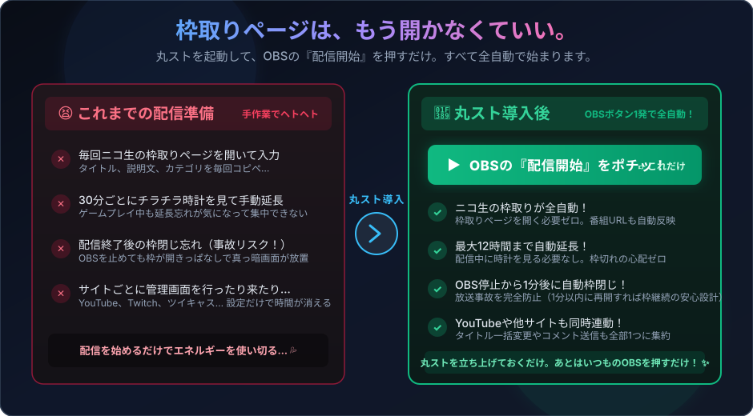
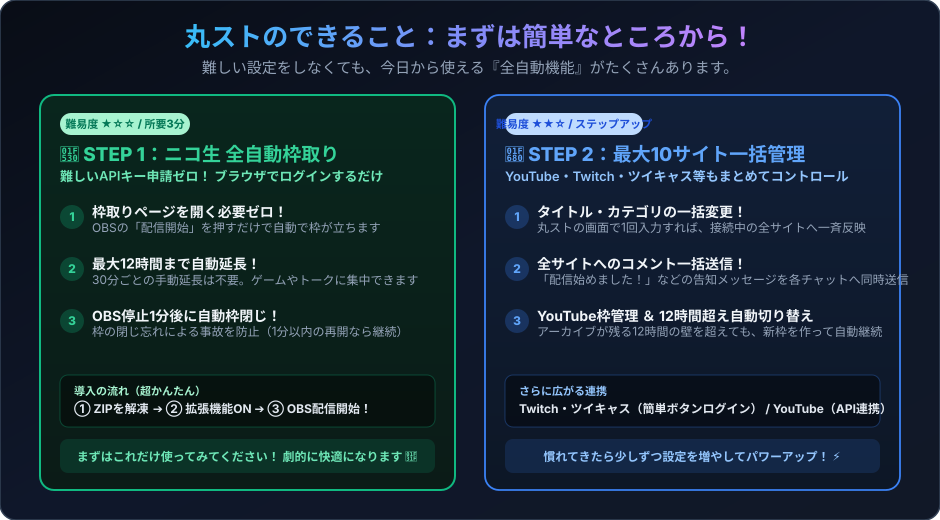
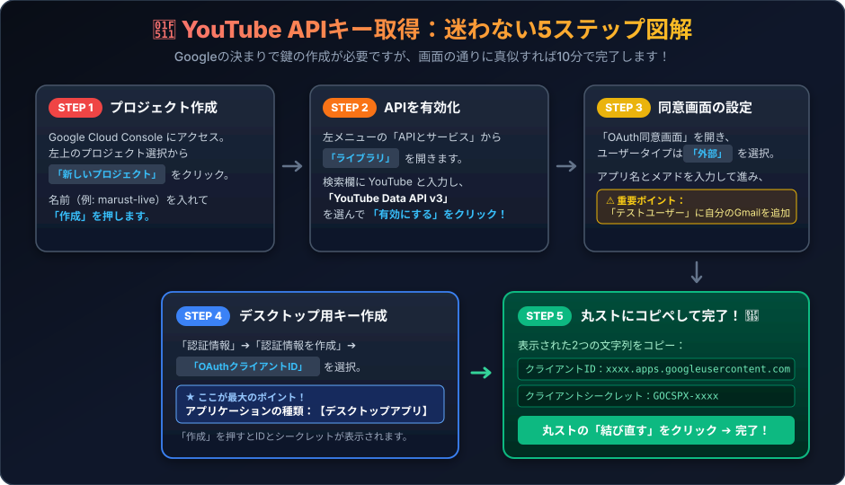
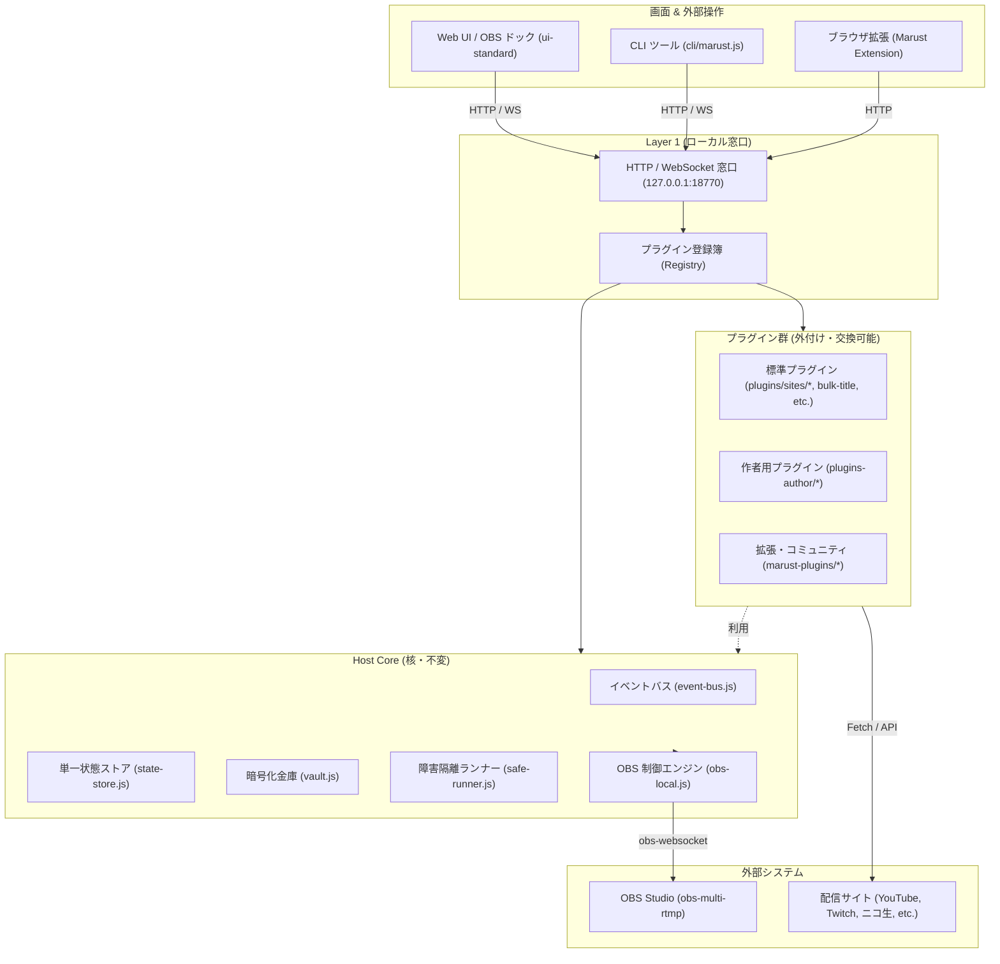

# 丸スト（marust）

> **「枠取りページは、もう開かなくていい。」**  
> 丸ストを起動して、OBSの『配信開始』ボタンを押すだけ。  
> ニコ生もYouTubeも自動で枠が立ち、終われば自動で枠が閉じる、配信者のための全自動アシスタント。

[](docs/images/hero-one-button.svg)

---

## 1. 💡 これで何が楽になるの？（Before / After ＆ 3つの最大の売り）

日々の配信や複数サイトへの同時配信で、こんな面倒な作業に追われていませんか？

- 😫 **配信前の準備**: 毎回ニコ生やYouTubeの管理画面を開いて、タイトルや説明文をコピペして枠取り…
- 😫 **配信中の気苦労**: 「あ、もう30分経つ！ニコ生の延長ボタン押さなきゃ…」とチラチラ時計を気にする…
- 😫 **配信後のヒヤリハット**: OBSを止めたのに、ニコ生の枠を閉じ忘れて真っ暗な画面が何時間も放置される（放送事故のリスク！）…

**丸スト（marust）を使えば、これらの作業がすべて全自動になります！**

### 🌟 売り①：ニコ生は「難しいAPI申請ゼロ」！すぐ自動で枠が立つ・延びる・閉じる！
- **枠取り画面を開く必要なし**: OBSの「配信開始」ボタンを押すだけで、自動でニコ生の枠が立ち上がります。
- **最大12時間まで自動延長**: 30分ごとの手動延長はもう不要。ゲームやトークに完全に集中できます。
- **OBS停止1分後に自動枠閉じ**: OBSで「配信停止」を押すと、**1分後にニコ生の枠を自動で閉じてくれます**。
  - ※「あ、間違えて配信停止押しちゃった！」という時も、1分以内にOBSの配信を再開すれば自動枠閉じは自動キャンセルされる安心設計です。

### 🌟 売り②：OBSの「配信開始」ボタン一発で、いつもの同時配信がすぐ始まる！
- 丸ストを裏で起動しておくだけ。あなたの配信ルーティンは **「OBSの配信開始ボタンを押す」** 、たったこれだけです。
- 万が一、丸ストがフリーズしたり閉じたりしても、**OBSの配信そのものは絶対に止まりません**（映像を送っているのはOBS自身だからです）。

### 🌟 売り③：少し設定を足せば「10サイト一括変更」「コメント一括送信」「YouTube自動枠取り」も！
- ニコ生だけなら3分で導入完了。慣れてきたら、YouTube・Twitch・ツイキャス・FC2など最大10サイトへ一気にステップアップできます。

[](docs/images/step-by-step-levels.svg)

---

## 2. 🚀 はじめての導入ガイド（プログラム知識ゼロでOK！かんたん3ステップ）

黒い画面（コマンドプロンプト）やプログラミングの知識は一切不要です。マウス操作だけで始められます。

### ステップ 1：ダウンロードして解凍する
1. GitHubの [Releases ページ](../../releases) を開きます。
2. 最新バージョンの Assets から `marust-x.x.x-minimum-win-x64.zip`（または `full` 版）をダウンロードします。
3. ダウンロードした ZIP ファイルを右クリックして「すべて展開」をクリックします。
4. 展開されたフォルダの中にある **`marust.exe`** をダブルクリックして起動します。

> 💡 **「WindowsによってPCが保護されました」と青い画面が出たら？**  
> 個人開発の新しいソフトのため警告が出ることがあります。  
> **「詳細情報」** をクリックし、現れた **「実行」** ボタンを押せば通常通り起動します。

### ステップ 2：ニコニコ生放送をつなぐ（APIキー不要・一番かんたん！）
1. 丸ストの画面が開いたら、Chrome または Edge ブラウザでニコニコ生放送に普段通りログインしておきます。
2. 付属のブラウザ拡張機能をブラウザに登録する（またはログイン案内をクリックする）だけで、自動的に連携されます。面倒なペアリングコードやAPIキー入力は一切ありません。
3. ニコ生の設定欄で **「自動枠取り」** と **「OBS停止から1分後に自動で枠を閉じる」** がONになっていることを確認します。

### ステップ 3：OBSの「配信開始」ボタンを押す！
- あとはいつも通り、OBS Studio の **「配信開始」** ボタンをポチッと押すだけ！
- 丸ストが自動的にニコ生の枠を立ち上げ、配信がスタートします。終わったらOBSの「配信停止」を押せば、1分後に枠が綺麗に閉じます。

---

## 3. 🎨 ステップアップ①：タイトル一括変更・コメント一括送信を使うには

配信に慣れてきたら、Twitch や ツイキャス、FC2 などの他サイトも連携してみましょう！

1. 丸スト画面の各サイトの横にある **「ログインの準備」** ボタンをクリックします。
2. サイトごとの認証画面（Webブラウザ）が開くので、「ログイン」や「許可する」を押すだけで接続完了です。
3. これで、丸スト上の入力欄にタイトルを入れるだけで、**全サイトの文字数制限に合わせて一括でタイトルが書き換わります**。
4. 丸ストからメッセージを入力すれば、各サイトのチャット欄へ「配信開始しました！」などの案内を**一括送信**できます。

---

## 4. 🔑 ステップアップ②：YouTube も連携したい人へ（YouTube APIキーの取り方・完全図解ガイド）

YouTube の自動枠取りやタイトル変更を行うには、Google の規約により **「自分専用の合鍵（クライアントIDとシークレット）」** を Google の公式サイトで1度だけ作成する必要があります。

> 💬 **「難しそう…」と思っても大丈夫！**  
> 以下の図解と手順のとおり、同じボタンをクリックしていくだけで約10分で作れます（完全無料です）。

[](docs/images/youtube-oauth-guide.svg)

### 迷わない5ステップ手順

#### ① Google Cloud Console でプロジェクトを作成
1. ブラウザで [Google Cloud Console](https://console.cloud.google.com/) にアクセスし、Googleアカウントでログインします。
2. 画面上部の「プロジェクトの選択」（または組織の選択）をクリックし、ポップアップ右上の **「新しいプロジェクト」** をクリックします。
3. プロジェクト名にわかりやすい名前（例: `marust-live`）を入力し、**「作成」** を押します。

#### ② YouTube Data API v3 を有効化
1. 左上の三本線メニュー（≡）から **「APIとサービス」** ➔ **「ライブラリ」** をクリックします。
2. 検索バーに `YouTube` と入力し、一覧から **「YouTube Data API v3」** を選択します。
3. 青い **「有効にする」** ボタンをクリックします。

#### ③ OAuth 同意画面を設定（自分のメアドを登録）
1. 左メニューの **「OAuth 同意画面」** をクリックします。
2. ユーザータイプで **「外部」** を選択し、「作成」を押します。
3. アプリ情報で「アプリ名（例: marust）」と「ユーザーサポートメール（自分のGmailアドレス）」を入力して一番下の「保存して次へ」を押します。
4. 「スコープ」はそのまま「保存して次へ」を押します。
5. **★最重要ポイント：** 「テストユーザー」の画面で **「＋ ADD USERS（ユーザーを追加）」** をクリックし、**自分の配信を行う Google/YouTube のメールアドレス** を入力して保存します。

#### ④ デスクトップアプリ用の認証情報を作成
1. 左メニューの **「認証情報」** をクリックします。
2. 画面上部の **「＋ 認証情報を作成」** ➔ **「OAuth クライアント ID」** を選択します。
3. **★ここが一番間違えやすいポイント：**  
   アプリケーションの種類で、必ず **【デスクトップ アプリ】** を選んでください（「ウェブ アプリケーション」ではありません）。
4. 名前は適当（例: `marust desktop`）のままで **「作成」** をクリックします。

#### ⑤ 丸ストに貼り付けて「結び直す」をクリック！
1. 画面に **「クライアント ID」**（`xxxx.apps.googleusercontent.com`）と **「クライアント シークレット」**（`GOCSPX-xxxx`）が表示されます。
2. それぞれコピーして、丸ストの画面の該当欄に貼り付けます。
3. **「結び直す」** ボタンをクリックするとブラウザで Google ログイン画面が開くので、先ほど登録した自分のアカウントを選んで「続行」を押せば完了です！🎉

---

## 5. ❓ よくある質問とトラブルシューティング

- **Q. 丸ストを閉じたら配信はどうなりますか？**  
  **A.** 配信は絶対に止まりません。映像の送出は OBS が直接行っているため、丸ストを終了・再起動しても配信はそのまま継続します。
- **Q. ニコ生の枠が自動で立たないときは？**  
  **A.** ブラウザでニコニコにログインできているか、また丸スト画面で「自動枠取り」がONになっているか確認してください。
- **Q. YouTube の認証で「アクセスをブロック: このアプリは審査されていません」と出る**  
  **A.** 上記ステップ③の「OAuth 同意画面」➔「テストユーザー」に、ログインしようとしている Google アカウントのメールアドレスが登録されているか確認してください。
- **Q. コメントの受信はどうすればいいですか？**  
  **A.** コメントの受信と表示には、定番の [わんコメ（OneComme）](https://onecomme.com/) をご利用ください。丸ストはコメントの「一括送信」を担当し、受信ツールと綺麗に役割分担しています。

---

<details>
<summary>🛠️ 開発者・プラグイン制作者向けドキュメント（設計思想・4層構造・プラグイン開発）</summary>

## 6. 丸ストのアーキテクチャ・設計思想

### 6.1 丸ストとは何か・何をしようとしているのか

**丸スト（marust / MultiStreamHub）** は、YouTube、ニコ生、Twitch、ツイキャス、Kick、FC2、Kukulu、Picarto、Rumble、SOOP など、**10以上の配信サイトで同時配信を行う配信者のためのローカル完結型オーケストレーター** です。

複数サイトへの同時配信には、配信前の各サイトでの枠取りやタイトル・カテゴリ変更、ログイン期限切れの確認、OBS のマルチ RTMP プラグイン（`obs-multi-rtmp`）との同期、コメント欄の監視など、膨大な手作業と精神的負荷が伴います。

丸ストは、これらの作業をローカルPC上の単一ウィンドウ（および OBS ドック）に統合し、以下の自動化・一元管理を実現します：

- **一括タイトル・カテゴリ更新**: 1つの入力欄から、接続中の全配信サイトへ各サイトの文字数制限やタグ仕様に合わせて一斉反映。
- **OBS連動の一括配信開始・即時非常停止**: OBS のメイン出力および `obs-multi-rtmp` の全配信先を1クリックで連動開始。万一の事故時は「全部止める」で即座に全送出を切断。
- **ログイン・認証状態の可視化**: 「Cookieが切れているのか」「チャンネルIDが未設定なのか」「OAuth連携が必要なのか」を各サイトが自律申告。
- **枠取り・コメント・外部連携**: 自動枠取りプラグイン、わんコメ（`OneComme`）とのコメント中継、配信タイマー（`NeonTimerApp`）、Google カレンダー連携などをモジュール化。

---

### 6.2 なぜこの設計なのか（概念・大事にしている7つの原則）

丸ストの構造は、作者の実配信における数々のトラブルと教訓、そして ADR（アーキテクチャ決定記録）を経て導き出された **7つの設計原則** に基づいています。

```
+--------------------------------------------------------------------------+
|                        7つの不変設計原則                                   |
| 1. 配信を絶対に止めない (OBS独立)      2. 核は不変・画面もすべてプラグイン |
| 3. 金庫(Vault)による秘密保護           4. サイト自身の自己申告(loginNeeds) |
| 5. Safe-Runner (8秒制限・障害隔離)     6. 段階的検証 (legacy/shadow/live)  |
| 7. 4層分離と公開純粋性                                                    |
+--------------------------------------------------------------------------+
```

#### ① 配信を絶対に止めない（OBS独立性）
配信者の生命線は「映像と音声が視聴者に届き続けること」です。  
丸ストは OBS Studio と WebSocket 経由で通信しますが、**丸ストがクラッシュ・フリーズ・再起動しても、OBS の配信送出は1フレームも途切れません**。  
丸ストは OBS の「司令塔」であって「中継所」ではないため、配信の継続性は OBS 単体に完全に委ねられます。

#### ② 核（Core）は不変、画面もサイトもすべてプラグイン（計画C / ADR 0007・ADR 0002）
丸ストにおける「核（Core）」には2段階の境界があります：
1. **製品としての核（Core Build / ADR 0007）**:  
   「核の大事な点は、小さいことではなく**変わらないこと**」（[ADR 0007](docs/adr/0007-core-is-what-does-not-change.md)）。  
   製品バイナリ（`marust.exe`）として1度だけビルドされる部分であり、配信核（`host/core/`）、ローカル窓口・ペアリング・プラグイン登録簿・トレイ（`host/layer1/`）、画面の入れ物（`ui/`）を含みます。これ以外の画面パネルやサイト連携ロジックはすべて外付けプラグイン（`plugins/`）化されており、UIの改修やサイトAPIの仕様変更があってもバイナリの再ビルドは不要で、ホットリロードだけで瞬時に反映されます。
2. **28ファイル固定の配信核（`host/core/` / ADR 0002）**:  
   「公開版の核は『全部を出す』と『全部を止める』だけ」（[ADR 0002](docs/adr/0002-core-is-start-and-stop.md)）。  
   製品核の中でも最も変更が許されない中枢（配信先管理・金庫・イベントバス・Safe-Runner・配信エンジン抽象）であり、ファイル数上限（28ファイル）・行数上限（5,650行）およびコア門番（`cli/check-core-guard.js`）によって不変性と純粋性が厳格に守られています。

#### コア（核）の根本思想：「変えないために、過不足なく持つシンプルで最低限の構造」
丸ストの配信核（`host/core/`）が目指している究極の価値は、単にコードが「小さいこと」ではなく、**「今後二度と作り直さなくて済むこと（不変性）」** です（[ADR 0007](docs/adr/0007-core-is-what-does-not-change.md)）。

システムを「変えないで安定させる」ためには、2つの罠を避ける必要があります：
- **大きすぎることへの戒め**: コアに特定サイトの仕様やUIの都合を持ち込めば、サイト側の些細な仕様変更に引きずられてコアの改修と再配布が必要になってしまう。
- **小さすぎることへの戒め**: コアが必要な土台を持っていなければ、運用を重ねるうちに機能が足りなくなり、後からコアに継ぎ接ぎ（パッチ）を当てざるを得なくなる。

丸ストのコアは、**「やりたいこと（マルチ配信制御・暗号化秘密保護・障害隔離・状態同期・ライフサイクル管理）に必要な土台をすべて持っていながら、シンプルで必要最低限（過不足なし）」** という黄金比の構造を極限まで突き詰め、厳格なファイル数・行数上限（Ceiling Ratchet: 28ファイル / 5,650行）によってロックされています。

#### OBSに依存しないための「意図された余白（Engine Abstraction）」
丸ストは現在、OBS Studio（および `obs-multi-rtmp` プラグイン）を主力配信エンジン（`engine.id: "obs-local"`）として連動していますが、**決して「OBS 専用ソフト」ではありません**。

将来、**OBS 以外の配信ソフト（XSplit、Streamlabs、FFmpeg/SRT 直接送出エンジンなど）** を使う可能性を見据え、丸ストのコアには設計の最初から **「配信ソフト非依存の余白」** が意図的に組み込まれています：
- **配信先データ構造の抽象化**: 配信先（`state-store.js`）は、OBS固有のターゲットではなく `{ id, site, engine: { id, targetId } }` として抽象化されています。
- **エンジン登録簿（`EngineRegistry`）**: コアのエンジン層（`host/core/engine/index.js`）は、複数の配信エンジンを束ねる登録簿を持っており、`dest.engine.id` に応じて適切な配信エンジンへルーティングされます。

そのため、将来もし配信ソフトを乗り換える場合でも、**コア（`host/core/`）も、10サイトの連携プラグインも、画面（UI）も一切書き換える必要はありません**。新しい配信ソフト用のエンジンアダプタを1つ登録するだけで、一括配信開始も即時非常停止もそのまま動作します。

#### ③ 金庫（Vault）による秘密情報の徹底保護
OAuth トークン、セッション Cookie、ストリームキーなどの機微情報は、OS のネイティブ暗号化（Windows DPAPI / Electron `safeStorage`）を用いた「金庫（`vault.js` / `state/services/marust-vault.json`）」またはエンジン側（OBS プロファイル設定）にのみ保存されます。  
- 画面、ログファイル、エラーメッセージ、API 応答には **絶対に生の値を出力せず、末尾4文字のみ（例: `...ab12`）を表示** します。
- エクスポート時も秘密情報は自動的に除外されます。
- 一方、各機能やサイトの動作モード（`legacy` / `shadow` / `live`）などの非機微な設定は、状態ファイル（`state/services/marust-modes.json`、作者環境では `author-modes`）で分離管理されます。

#### ④ サイト自身が「足りない物」を自己申告する（計画N: `loginNeeds`）
コアは各配信サイト固有の認証仕様（Cookieが必要か、OAuthか、チャンネルIDか）を一切知りません。  
サイトプラグイン自身が `loginNeeds()` を通じて、**「何が足りないか（need: `cookies` / `channel` / `oauth`）」「どう入れるか（how: `extension` / `browser` / `input`）」を画面に自己申告** します。

#### ⑤ 1プラグインの故障が全体を巻き込まない（Safe-Runner 障害隔離・Promise レース）
1つのサイトの外部APIがネットワーク障害でタイムアウトしても、他サイトへのタイトル送信や配信開始がブロックされてはなりません。  
すべてのプラグイン実行は **Safe-Runner（既定8秒タイムアウト、manifest の `timeouts` で変更可）** で保護・隔離されます。  
- **保証の範囲**: タイムアウト発生時に呼び出し元へ即座にタイムアウト応答を返却し、後続のキューや他サイトの処理をブロックしないための仕組み（Promise レース）です。
- **プラグイン側の契約責務**: プラグインとコアは同一プロセス（inproc）で動作するため、同期的な無限ループを OS レベルで強制停止（kill）することはできません。外部 HTTP 通信のタイムアウト中断（`AbortSignal` 等の活用）や非同期処理の重複実行防止は、各プラグインが正しく遵守すべき契約責務です。

#### ⑥ 段階的モード（`legacy` / `shadow` / `live`）
外部APIへの送信は、いきなり本番実行するリスクを避けるため3段階のモード（`state/services/marust-modes.json`）を持っています：
- **`legacy`**: 丸ストからは何もしない（手動運用または旧ツールに任せる）。
- **`shadow`**: 実際のリクエストは送らず、送信内容を検証・ローカル記録のみ行う（dryRun）。
- **`live`**: 実際にサイトの API へ本番送信する。

#### ⑦ 4層分離と公開版の純粋性（計画L / 計画M）
核（Core）、窓口（Layer 1）、標準プラグイン（Public）、作者専用プラグイン（Author）の4層を物理的・論理的に分離。オープンソースとして配布されるパッケージには、作者個人の認証情報やローカル常駐ツール依存コードが 1 行も混入しません。

---

### 6.3 システム構成要素とディレクトリ構造

丸ストの全体構造は以下のレイヤーとディレクトリで整理されています。



#### ディレクトリ一覧

- **`host/core/`（核 / Core）**:
  - 全28ファイル・不変。OBS 通信（`engine/`）、OS 暗号化金庫（`vault.js`）、イベントバス（`event-bus.js`）、状態ストア（`state-store.js`）、障害隔離（`safe-runner.js`）。
- **`host/layer1/`（一層目 / 窓口）**:
  - ローカル窓口（`127.0.0.1:18770`）、拡張機能からの Cookie 受信、API 権限・承認（ペアリング）、プラグインローダー。
- **`plugins/`（標準プラグイン / Public）**:
  - `ui-standard`（標準画面シェル・ドックUI）、`bulk-title`（一括タイトル更新）、`sites/*`（10サイトの個別連携）、`site-login`（ログイン管理パネル）、`diagnostics`（診断）、`backup`（バックアップ）等。
- **`plugins-author/`（作者専用プラグイン / Author）**:
  - 作者の個人配信用設定（`author-modes`）、旧環境データ救出（`dev-legacy-import`）、作者用常駐ツール連携（`ext-nico`, `ext-monitor`）。
- **`../marust-plugins/plugins/`（拡張・コミュニティプラグイン）**:
  - `timer`（配信カウントダウン・アップ）、`gcal`（Google カレンダー連動枠管理）、`tips`（操作ヒント）など。
- **`browser_extensions/marust_extension/`**:
  - Chromium 用拡張機能（Manifest V3）。各サイトのログイン Cookie やキャプチャ情報を安全に丸ストの金庫へ転送。

---

### 6.4 起動方法とプラグインの仕組み

丸ストは、**「誰でも特別な設定やプログラムなしで、exeをダブルクリックするだけで動く」** ように設計されています。

#### プラグイン読み込みの基本仕様（一般ユーザーと同じ仕組み）
パッケージ版（配布版）の `marust.exe` を直接ダブルクリックして起動した場合、丸ストは自動的に **「`marust.exe` の横にある `plugins/` フォルダ（`<exeのあるフォルダ>/plugins/`）」** の中身をスキャンしてすべて読み込みます。バッチファイル、環境変数の設定、`build-info.json` の変更などは一切不要です。

- **一般の人がプラグインを追加する2つの方法**:
  1. **画面から入れる（推奨）**: 丸スト起動後、画面の「プラグインを入れる」から zip やフォルダを選択する（安全検証され、ユーザーデータ領域へ自動配備されます）。
  2. **フォルダに直接置く**: `marust.exe` の隣の `plugins/` フォルダの中に、プラグインフォルダをそのまま置く。次回起動時に自動ですべて読み込まれます。

#### 作者環境で「全部入り（73プラグイン）」を立ち上げる方法
作者環境で標準プラグイン・コミュニティプラグイン・作者専用ツールをすべて読み込んだ状態で立ち上げるには、作業スタイルに合わせて以下のいずれかを選択します：

##### 方法 A: 一般ユーザーと全く同じ環境で作業したい場合（exe 直接ダブルクリック）
`dist/editions/full/plugins/` フォルダの中に、追加したいプラグインフォルダ（`plugins-author/` 配下の各フォルダや `../marust-plugins/plugins/` 配下の各フォルダ）をそのままコピーして配置します。
あとは **`dist/editions/full/marust.exe` を直接ダブルクリックして起動するだけ** です。一般ユーザーと1ミリも違わない標準動作で、配置された全プラグインが読み込まれます。

##### 方法 B: リポジトリのコードを直接開発・編集しながら作業したい場合（CLI ヘルパー）
プラグインのソースコードを修正しながら確認する場合、毎回 `dist/` にファイルをコピーし直すのは手間がかかります。
`cli/start-author.cmd` を実行すると、環境変数（`MARUST_SET_DIR`）経由でリポジトリ側のソースフォルダ（`plugins/`, `../marust-plugins/plugins/`, `plugins-author/`）を直接参照した状態で `marust.exe` を起動できます。

```powershell
# 方法 A: 配布版と同じ構造で直接起動（dist の plugins/ 内を読み込み）
.\dist\editions\full\marust.exe

# 方法 B: リポジトリのソースコードを直接読み込んで起動（開発用ショートカット）
.\cli\start-author.cmd
```

起動後、ブラウザまたは OBS ドックで `http://127.0.0.1:18770/` を開くことで操作できます。

#### 配布用エディション（公式ビルド）
- **`minimum` 版** (`dist/editions/minimum/`): 配信先制御と基本画面に絞った軽量エディション（23プラグイン）。
- **`full` 版** (`dist/editions/full/`): 全10サイト連携や枠取りプラグインを含む公式フルセットエディション（標準37プラグイン）。

#### 開発・診断コマンド
作業時の構文検査、テスト、診断は以下のコマンドで行います（`streaming/marust/` で実行）：

```powershell
# 全単体・結合テストの実行
npm test

# JavaScript 構文チェック
npm run check

# コア不変ガード・純粋性検査 (チェック・改善記録の確認)
node cli/check-core-guard.js

# 丸ストの状態確認 (CLI)
node cli/marust.js status

# 特定プラグインのホットリロード (開発者モード時)
node cli/marust.js plugin reload <plugin-id>
```

---

### 6.5 プラグインの作り方（実践ガイド）

丸ストの拡張は、すべてプラグインとして作成します。**コアを書き換える必要は一切ありません**。

#### 基本構成
1つのディレクトリに `manifest.json` と `index.js`（および必要に応じて `ui/` 等）を配置します。

```text
my-plugin/
├── manifest.json   # プラグイン定義と権限・役割の宣言
└── index.js        # ロジック本体
```

#### `manifestVersion: 2` の書き方

```json
{
  "id": "my-cool-plugin",
  "name": "便利機能プラグイン",
  "version": "1.0.0",
  "manifestVersion": 2,
  "kind": "tool",
  "category": "tool",
  "provides": [
    "ui.panel@1"
  ],
  "needs": [
    "storage",
    "events.subscribe"
  ],
  "secrets": [
    "myplugin.token"
  ],
  "panels": [
    {
      "name": "main",
      "title": "便利ツール",
      "file": "ui/panel.html"
    }
  ]
}
```

#### パターン別実装テンプレート

##### パターン A: 配信サイトプラグイン（`stream.site@1`）
配信サイトのタイトル更新やログイン状況を管理するプラグインです。

```javascript
// plugins/sites/mysite/site.js
'use strict';

module.exports = function createMySite(deps) {
  let ctx = null;

  // 1. 不足している認証情報を自律申告
  async function loginNeeds() {
    if (ctx.mode() === 'legacy') {
      return { ready: false, need: 'mode', how: 'toggle' };
    }
    const token = await ctx.secrets.get('mysite.token');
    if (!token) {
      return { ready: false, need: 'token', how: 'input' };
    }
    return { ready: true, need: null, how: 'input' };
  }

  // 2. 準備完了判定
  async function isConfigured() {
    return (await loginNeeds()).ready;
  }

  // 3. タイトル・メタデータ更新
  async function updateMetadata(payload, meta) {
    const mode = ctx.mode();
    if (mode === 'legacy') return { ok: false, error: 'legacy' };
    
    const title = (payload && payload.title) || '';
    if (!title.trim()) return { ok: false, error: 'empty-title' };

    // shadow モードまたは dryRun の場合は本番送信しない
    if (mode === 'shadow' || (meta && meta.dryRun)) {
      ctx.logger('info', 'dryRun 更新シミュレーション成功: ' + title);
      return { ok: true, dryRun: true };
    }

    // live モード: 実際の API 呼び出し
    const token = await ctx.secrets.get('mysite.token');
    await fetch('https://api.mysite.com/update', {
      method: 'POST',
      headers: { 'Authorization': 'Bearer ' + token },
      body: JSON.stringify({ title: title })
    });

    return { ok: true };
  }

  return {
    load(context) { ctx = context; },
    loginNeeds,
    isConfigured,
    updateMetadata
  };
};
```

##### パターン B: イベント購読・API 公開プラグイン
OBS の配信開始イベントを受け取ったり、CLI / Web UI から呼び出せる API を追加するプラグインです。

```javascript
// plugins/my-notifier/index.js
'use strict';

module.exports = {
  load(ctx) {
    // イベントバスの購読
    ctx.bus.subscribe('stream.started', (eventName, payload) => {
      ctx.logger('info', '配信が開始されました: ' + payload.destinationId);
    });

    // 独自 API の公開 (CLI: marust call notifier.ping)
    if (ctx.api) {
      ctx.api.register('notifier.ping', async (params) => {
        return { ok: true, message: 'pong: ' + (params.text || '') };
      }, {
        access: 'read',
        description: '疎通確認用 API'
      });
    }
  }
};
```

##### パターン C: 画面パネルプラグイン
Web UI や OBS ドックのグリッド内にカスタムパネルを追加します。

```html
<!-- ui/panel.html -->
<!DOCTYPE html>
<html>
<head>
  <meta charset="utf-8">
  <link rel="stylesheet" href="../../ui/theme.css">
</head>
<body style="padding: 12px; color: var(--text-color, #eee);">
  <h3>カスタムモニター</h3>
  <div id="output">待機中...</div>
  <script>
    window.addEventListener('message', (event) => {
      if (event.data && event.data.type === 'stateUpdate') {
        document.getElementById('output').textContent = event.data.status;
      }
    });
  </script>
</body>
</html>
```

#### プラグイン作成時の鉄則
1. **外側のモジュールを `require` しない**:  
   プラグインフォルダの外（`../../host/core` や `../../lib`）を直接 require してはなりません。必要な機能はすべて `ctx`（つなぎ口）経由で受け取ります。
2. **秘密情報をログに出さない**:  
   トークンや Cookie を `console.log` や `ctx.logger` に生で出力してはなりません。伏字化するか `secretTail` を使用してください。
3. **8秒ルールを意識する**:  
   外部 API との通信には適切なタイムアウト（`AbortController` 等）を設定し、ハングしないように実装してください。

---

### 6.6 コア（`host/core/`）の不変ルールと変更時の手続き

丸ストでは、核（Core）の安定性と信頼性を極限まで高めるため、**「コア不変ガード規約」** を設けています。

#### コア改修前の確認チェック
もし `host/core/` を改修しようと考えたときは、必ず以下の手順を踏んでください：
1. **代替案の検証**: 「本当にプラグインや `host/layer1/` で実現できないか？」を自問する。99%の機能拡張はプラグインで実現できます。
2. **門番チェッカーの実行**:
   ```powershell
   node cli/check-core-guard.js
   ```
3. **改修理由と改善内容の記録**:  
   やむを得ずコアを改修した場合は、コミット前に必ず **[`docs/CORE-CHANGELOG.md`](docs/CORE-CHANGELOG.md)** に審査理由、改善内容、境界テスト結果を記録してください。`check-core-guard.js` は、記録がない変更をエラーとして遮断します。

---

### 6.7 将来への展望（Future Roadmap / 今は作らず余白のみ残す構想）

> [!NOTE]
> **現在実装済みの保証と将来構想の分離**:  
> 現行バージョンで実装・保証されているのは **「ローカルPC完結・OBS連動」** です。以下に述べるクラウド中継（`cloud-relay`）やスマホ連携等は、**現時点では実装されておらず、[ARCHITECTURE.md §15](docs/ARCHITECTURE.md#15-将来の拡張構想今は作らない意図を残す) の方針に従い「コードは書かず、データ構造（`stream.engine` の `{ id, targetId }` 等）の余白として意図のみを残す」将来構想** です。

丸ストは、現在の「ローカルPC完結・OBS連動」を最高峰の安定性と完成度で維持しつつ、将来の配信スタイルの進化に応える以下の拡張展望を設計上の「余白」として保持しています（詳細は [ARCHITECTURE.md §15](docs/ARCHITECTURE.md#15-将来の拡張構想今は作らない意図を残す) 参照）。

#### 展望① 多様な配信ソフト・ローカルエンジン対応
- **OBS以外の配信ソフト連携**: XSplit や Streamlabs Desktop、独自 RTMP/SRT 送出エンジンなどのアダプタを追加し、配信者の好みの配信ソフトウェアをシームレスに選択可能にします。
- **コア不変の維持**: どの配信ソフトを繋いでも、丸ストのコアやUI、サイトプラグインは1行も変更せず動きます。

#### 展望② クラウド配信エンジン（`cloud-relay`）構想
- **自宅上り回線の劇的な節約**: 自宅 PC からはクラウド中継サーバーへ「高品質な映像を1本だけ」送信し、クラウド側の配信エンジンがYouTube、Twitch、ニコ生など10サイト以上へ一斉に分配送出する構想です。
  - 自宅の上り回線が細くても（例: 6Mbps 1本分）、10サイト以上の超多重配信が可能になります。
  - 万一自宅 PC がブルースクリーンや停電で落ちても、クラウド側がストリームを保持・待機画面をループ送出することで、各サイトの配信枠が切断・終了してしまうのを防ぐ究極の耐障害性を実現します。
- **`stream.engine` による透過性**: 丸ストのコアからは、クラウド中継も1つのエンジン（`id: "cloud-relay"`）として抽象化され、ローカルOBSと全く同じインターフェースで制御されます。

#### 展望③ マルチデバイス・スマホ連携（Agent + Web UI）
- **手元デバイスからの安全操作**: 配信中の手元スマートフォンやタブレットのブラウザから、丸ストのローカル窓口（`127.0.0.1:18770`）へアクセスし、配信中のタイトル変更、コメント確認、緊急時の「全部止める（非常停止）」を手元ワンタップで行える操作環境を提供します。
- **PCの配信負荷をゼロに保つ**: 映像処理はPCが担い、スマホは純粋なコントローラー（Web UI / WebSocket クライアント）として動作するため、ゲーム配信等のフレームレートを1ミリも落とすことなく快適なマルチコントロールを実現します。

</details>

---

## 7. ライセンス
[LICENSE](LICENSE) をご覧ください。OBS 用の部品（`obs-multi-rtmp` の改造版）は、元と同じ GPL-2.0 で、別に配布しています。
